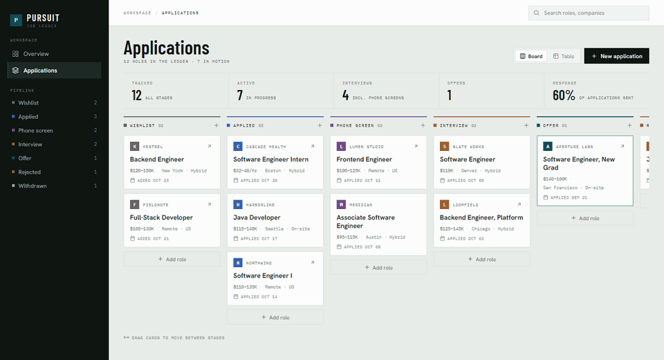
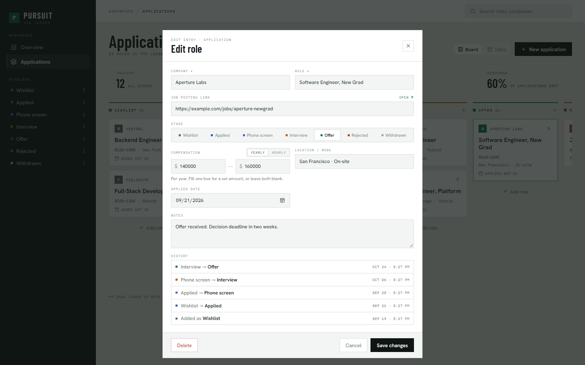
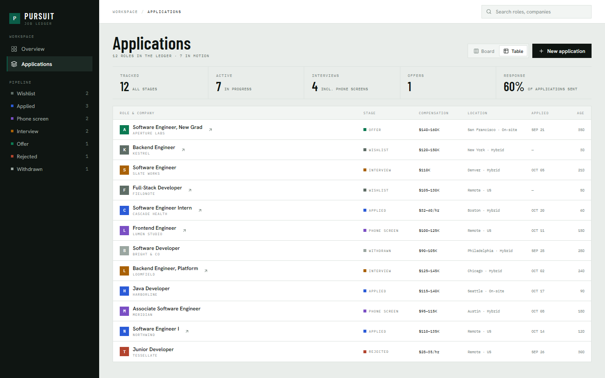
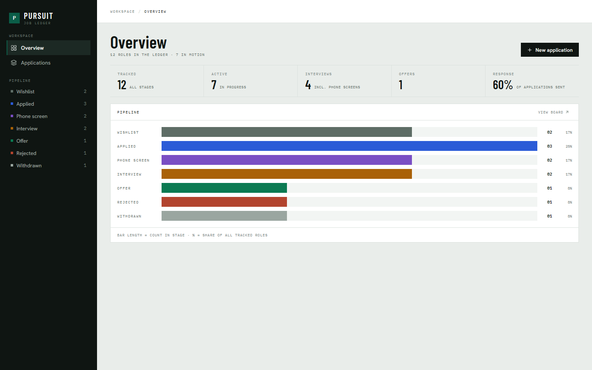

# Pursuit · Job Application Tracker

[](https://github.com/stevencobblestone/job-tracker/actions/workflows/ci.yml)

A full-stack app for tracking job applications on a kanban board.
Drag an application between columns to update its status; every status change is saved as history.

**Stack:** Spring Boot 3.5 (Java 21) · Angular 22 · PostgreSQL 16 · Flyway · Docker · GitHub Actions

<!-- Live demo: add the link here after deploying, e.g.
**[Live demo](https://pursuit.onrender.com)** (free hosting: the first load can take up to a minute) -->



| Edit pop-up with status history | Table view | Overview |
|---|---|---|
|  |  |  |

## Features

- Kanban board with one column per status: Wishlist, Applied, Phone screen, Interview, Offer, Rejected, Withdrawn
- Drag-and-drop between columns (Angular CDK) updates the status through the REST API
- Table view of the same data, plus search by company or role
- Add, edit and delete applications: company, title, URL, location, salary (yearly or hourly; a range, one amount, or blank), notes, applied date
- Status history: each change is logged as an event row and shown in the edit pop-up
- Applied date fills in automatically (today) when an application moves to Applied without one
- Job posting links open straight from the board, table and edit pop-up
- Stats strip (tracked, active, interviews, offers, response rate) and an Overview page with pipeline bars
- Input validation on both frontend and backend
- API integration tests against a real PostgreSQL (Testcontainers)

## Prerequisites

| Tool | Version | Check with |
|------|---------|------------|
| Java (JDK) | 21 | `java -version` |
| Node.js | 22.22.3+ or 24 LTS | `node -v` |
| Docker Desktop | any recent | `docker --version` |

For the Docker quick start, only Docker is needed. Java and Node are for local development and tests.
Maven doesn't need to be installed: the project includes the Maven Wrapper (`mvnw` / `mvnw.cmd`), which downloads it automatically.

## Quick start (everything in Docker)

Only Docker is needed. From the project folder:

```bash
docker compose up -d --build
```

Open **http://localhost:3000**. This builds and starts three containers: the database, the backend, and the frontend
(served by nginx, which also forwards `/api` to the backend). The first build takes a few minutes.

- Stop: `docker compose down` (your data is kept)
- After changing code, run the same `up -d --build` command again to rebuild
- Backend logs: `docker compose logs -f backend`

## Run it locally (for development)

This mode reloads the frontend automatically when you edit code. Open three terminals in the project folder.

**1. Start only the database** (PostgreSQL in Docker):

```bash
docker compose up -d db
```

**2. Start the backend** (API on http://localhost:8080). On first start, Flyway creates the tables.

```bash
cd backend
./mvnw spring-boot:run        # Windows: .\mvnw.cmd spring-boot:run
```

**3. Start the frontend** (http://localhost:4200):

```bash
cd frontend
npm install                   # first time only
npm start
```

Open **http://localhost:4200**. The frontend forwards `/api` requests to the backend (see `frontend/proxy.conf.json`).

To stop: press `Ctrl+C` in the backend and frontend terminals, then run `docker compose down`.
Your data is kept in a Docker volume. `docker compose down -v` deletes it.

## Run the tests

Docker must be running: the tests start their own temporary PostgreSQL container, so they never touch your real data.
GitHub Actions runs the same tests (plus a frontend build) on every push; see [`.github/workflows/ci.yml`](.github/workflows/ci.yml).

```bash
cd backend
./mvnw test                   # Windows: .\mvnw.cmd test
```

## Configuration

The backend reads its database connection from environment variables. The defaults match `docker-compose.yml`:

| Variable | Default |
|----------|---------|
| `DB_HOST` | `localhost` |
| `DB_PORT` | `5432` |
| `DB_NAME` | `jobtracker` |
| `DB_USER` | `jobtracker` |
| `DB_PASSWORD` | `jobtracker` |
| `DB_PARAMS` | *(empty)*. Extra connection options, e.g. `?sslmode=require` for hosted databases |
| `PORT` | `8080`. Hosting platforms set this automatically |
| `DEMO_DATA` | `false`. `true` loads 12 sample applications at startup and resets them nightly. **Wipes the database; only for a public demo** |

To use a hosted PostgreSQL database such as **Neon** (which the live demo uses), set these variables before starting the backend. No code changes are needed.

## Deploy the demo (free: Render + Neon)

The repo includes a [`render.yaml`](render.yaml) that sets up both services on [Render](https://render.com)'s free plan.
The database runs on [Neon](https://neon.tech)'s free plan, which doesn't expire.

1. **Push this repo to GitHub.**
2. **Create the database on Neon:** sign up, create a project, and open its connection details.
   Pick the **direct** connection (not "pooled"). You'll need the host (like `ep-xxxx.us-east-2.aws.neon.tech`),
   database name, user and password.
3. **Create the services on Render:** sign up with GitHub, then **New → Blueprint** and pick this repo.
   Render reads `render.yaml` and asks for `DB_HOST`, `DB_NAME`, `DB_USER` and `DB_PASSWORD`: paste the Neon values.
4. **Check the backend address.** Render names it `pursuit-api.onrender.com` when that name is free.
   If it got a different address, put it in the `/api/*` rule in `render.yaml`, push, and Render redeploys.
5. Open the frontend's address (`pursuit.onrender.com` or similar). You should see the sample data.

**Good to know:**
- The free backend **sleeps after 15 minutes** without visitors. The next visit waits up to a minute while it wakes up;
  the page shows a "waking up" message meanwhile.
- The demo has no login, so visitors can change the data. `DEMO_DATA=true` resets it on every restart and every night at 4 AM.
- Free plans change over time; check Render's and Neon's pricing pages if something behaves differently.

## REST API

Base URL: `http://localhost:8080/api`

| Method | Path | Description |
|--------|------|-------------|
| `GET` | `/applications` | List all applications |
| `GET` | `/applications/{id}` | Get one application |
| `POST` | `/applications` | Create (status defaults to `WISHLIST`) |
| `PUT` | `/applications/{id}` | Update all fields |
| `PATCH` | `/applications/{id}/status` | Change status only, e.g. `{"status": "INTERVIEW"}` |
| `DELETE` | `/applications/{id}` | Delete (its history is deleted too) |
| `GET` | `/applications/{id}/events` | Status history, oldest first |
| `GET` | `/stats` | Count per status |

Example request (bash or Git Bash; in Windows PowerShell, `curl` is a different command):

```bash
curl -X POST http://localhost:8080/api/applications \
  -H "Content-Type: application/json" \
  -d '{"company":"Acme","title":"Java Developer","salaryMin":90000,"salaryMax":110000,"status":"APPLIED"}'
```

Invalid input (missing company/title, min salary above max, unknown status) returns `400 Bad Request`.
A missing id returns `404 Not Found`.

## Project structure

```
job-tracker/
├── docker-compose.yml          # database + backend + frontend containers
├── render.yaml                 # free hosting setup (Render)
├── .github/workflows/ci.yml    # tests + build on every push
├── docs/screenshots/           # images used in this README
├── design/pursuit-ui.html      # UI design reference (open in a browser)
├── backend/                    # Spring Boot API (+ Dockerfile)
│   └── src/main/
│       ├── java/com/jobtracker/
│       │   ├── model/          # JPA entities + status enum
│       │   ├── repository/     # Spring Data repositories
│       │   ├── service/        # business logic (status history, stats)
│       │   ├── web/            # REST controller + request bodies
│       │   └── demo/           # sample data loader for the public demo
│       └── resources/
│           ├── application.properties
│           ├── demo-data.sql   # the 12 sample applications
│           └── db/migration/   # Flyway SQL migrations
└── frontend/                   # Angular app (+ Dockerfile, nginx.conf)
    └── src/app/
        ├── sidebar/            # left navigation + pipeline counts
        ├── metrics/            # stats strip under the page title
        ├── board/              # kanban board (drag-and-drop)
        ├── applications-table/ # table view
        ├── overview/           # pipeline bars page
        ├── application-form/   # "Add a role" add/edit/delete pop-up
        ├── icon/               # small set of inline SVG icons
        └── application.service.ts  # HTTP calls to the API
```

## Database

Two tables, created by the Flyway migrations in `backend/src/main/resources/db/migration/`
(`V1` creates the tables, `V2` adds the yearly/hourly pay type):

- `job_application`: one row per application
- `status_event`: one row per status change (`from_status` → `to_status`, with a timestamp)

To change the schema, add a new migration file (e.g. `V3__add_column.sql`). Never edit one that has already run.
